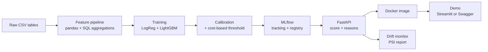

## 1. Overview

An end-to-end credit scoring system that predicts the probability of default of a loan applicant, turns it into a **cost-based approve / reject decision**, explains every decision with SHAP, and serves it through a tested, containerised API with drift monitoring.

**Why it matters for a bank:** a score alone is useless. A risk team needs calibrated probabilities, a threshold justified by money, reasons it can show a customer or a regulator, and a way to know when the model stops working. This project delivers all four.


## 2. Business question

> *Which applicants should we approve, and how much money does the model save compared with the current rule?*

| Element                  | Definition                                                          |
| ------------------------ | ------------------------------------------------------------------- |
| Unit                     | One loan application                                                |
| Target                   | `TARGET = 1` if the client had payment difficulties (default proxy) |
| Decision                 | Approve if $\hat{p}(\text{default}) < t$, reject otherwise          |
| Cost of a false negative | Approving a client who defaults: $\text{LGD} \times \text{EAD}$     |
| Cost of a false positive | Rejecting a good client: lost margin on the loan                    |
| Baseline to beat         | "Approve everyone" and a simple logistic regression                 |

### Cost matrix (explicit assumptions, written in the README)

|                   | Predicted good (approve)               | Predicted bad (reject)                      |
| ----------------- | -------------------------------------- | ------------------------------------------- |
| **Actually good** | 0                                      | margin × `AMT_CREDIT` (lost margin) |
| **Actually bad**  | LGD × `AMT_CREDIT` (loss on default) | 0                                           |

- **LGD = 45 %**: the Basel foundation-IRB reference value for senior unsecured exposures. State it as an assumption.
- **m = margin**: choose a value (for example 5 % of the credit amount over the loan life) and state it as an assumption.
- Run a **sensitivity analysis**: how does the optimal threshold move when LGD goes from 30 % to 60 %? This is what a risk manager will ask.

---

## 3. Success criteria (Definition of Done)

**Business**
- [ ] Expected cost per 1,000 applications: model vs "approve all" vs baseline, in euros
- [ ] Approval rate and default rate among approved clients at the chosen threshold
- [ ] Sensitivity of the threshold to LGD and margin assumptions


---

## 4. Data

### Home Credit Default Risk (Kaggle)

|              |                                                                                                                                                           |
| ------------ | --------------------------------------------------------------------------------------------------------------------------------------------------------- |
| Main table   | `application_train.csv`: about 307k applications, 122 columns                                                                                             |
| Target rate  | about 8 % positives (imbalanced)                                                                                                                          |
| Extra tables | `bureau`, `bureau_balance`, `previous_application`, `installments_payments`, `credit_card_balance`, `POS_CASH_balance`                                    |
| Why this one | Multi-table: you aggregate history into features, exactly like a bank's data mart. It also matches your SQL track (joins, aggregation, window functions). |

---

## 5. Architecture



### Repo structure
```
credit-risk-scoring/
├── README.md
├── Makefile                 # make data / train / test / serve
├── pyproject.toml
├── Dockerfile
├── .github/workflows/ci.yml
├── configs/config.yaml      # paths, costs (LGD, margin), model params
├── data/                    # gitignored, filled by scripts/download_data.py
├── notebooks/               # EDA only, numbered: 01_eda.ipynb, 02_quality.ipynb
├── src/credit_risk/
│   ├── data.py              # loading + cleaning
│   ├── features.py          # feature engineering
│   ├── train.py             # training + MLflow logging
│   ├── calibrate.py
│   ├── threshold.py         # cost matrix + optimal threshold
│   ├── explain.py           # SHAP
│   ├── drift.py             # PSI
│   └── api/main.py          # FastAPI app
├── tests/
├── docs/
│   ├── architecture.png
│   ├── model_card.md
│   └── figures/             # reliability curve, cost vs threshold, SHAP
└── scripts/download_data.py
```

### Stack
Python 3.11 · pandas · scikit-learn · LightGBM (or XGBoost) · SHAP · MLflow · FastAPI · Pydantic · pytest · Docker · GitHub Actions · Streamlit (optional front).

---
