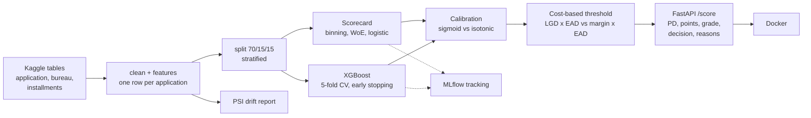
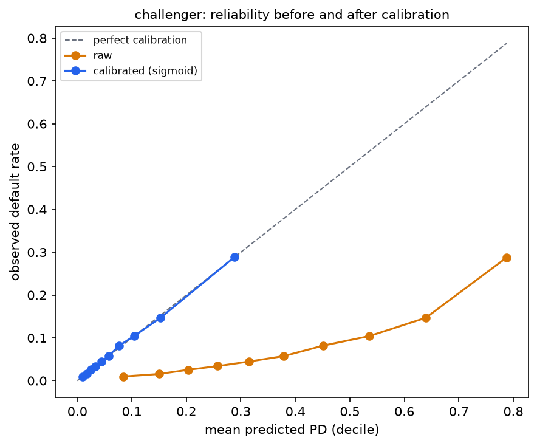
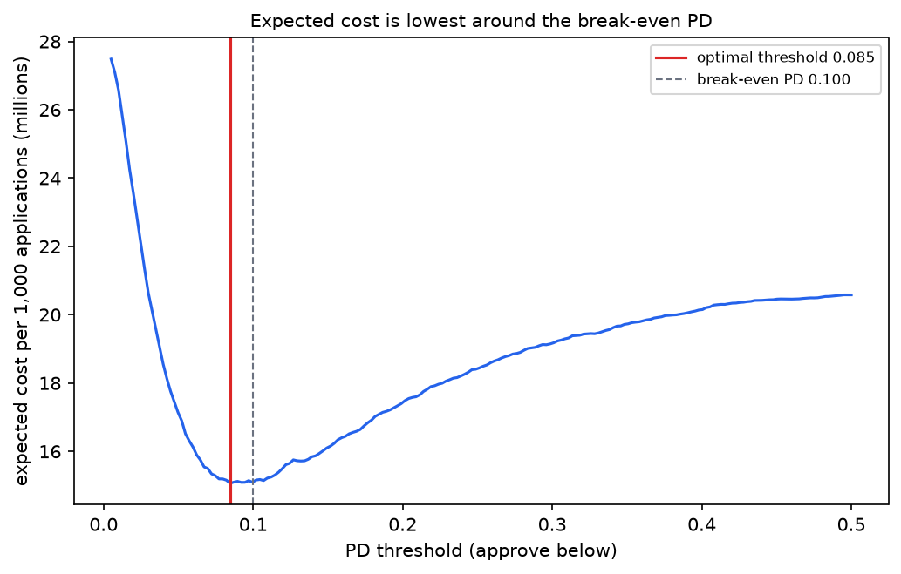
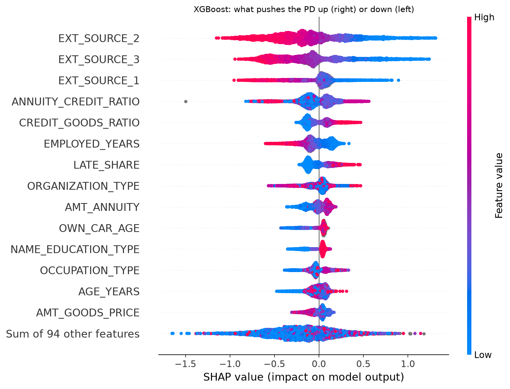

# Credit risk scoring: from a probability of default to a lending decision

An **application scoring** system for consumer loans: it estimates the probability of default (PD) of an applicant at origination, turns it into **scorecard points and a risk grade**, approves or rejects with a **threshold set by the cost of errors**, and tells a rejected applicant **why** in plain language. Served through a tested, containerised API with drift monitoring.

> **Scope:** PD at origination plus a decision. No LGD or EAD model is claimed; the expected-loss view uses an assumed LGD, clearly labelled.

## Result

On 46,127 held-out applications (test set, touched once):

| | Scorecard (champion) | XGBoost (challenger) |
|---|---|---|
| **Gini** | 0.495 | 0.555 (+0.059) |
| KS | 0.373 | 0.422 |
| Brier score (calibrated) | 0.0686 | 0.0667 |
| Approval rate at the cost-optimal threshold | 66.6 % | 73.3 % |
| Default rate among approved (vs 8.07 % overall) | 3.94 % | 3.93 % |
| Expected cost per 1,000 applications vs approving everyone | **-27.6 %** | -32.1 % |

The scorecard cuts the expected cost of 1,000 applications from 19.9 to 14.4 million (currency units of the dataset). The challenger approves 6.7 points more applicants at the same default rate: that is what its extra Gini is worth. The scorecard stays the champion because every decision it takes can be explained, point by point, to the applicant and to a regulator.

## How it works



| Step | Module | What it does |
|---|---|---|
| Data | `data.py` | Parquet cache, `clean()` (placeholder `DAYS_EMPLOYED = 365243` to NaN + flag, `XNA` codes, duplicate building columns), stratified split |
| Features | `features.py` | Affordability ratios, ages in years, credit bureau and instalment history aggregated per applicant (left join validated one-to-one) |
| Champion | `scorecard.py` | Optimal binning (`optbinning`), Weight of Evidence, IV filter, correlation filter, logistic regression with a sign check, points, grades A to E |
| Challenger | `challenger.py` | XGBoost with `scale_pos_weight`, 5-fold CV search with early stopping on train only |
| Calibration | `calibrate.py` | Sigmoid vs isotonic, compared out-of-fold on the calibration set |
| Decision | `threshold.py` | Cost curve, optimal threshold, sensitivity to LGD and margin, expected loss per grade |
| Explanations | `explain.py` | Reason codes from scorecard points, exact TreeSHAP for XGBoost, fairness table |
| Monitoring | `drift.py` | Population Stability Index, numeric and categorical |
| Product | `api/main.py`, `Dockerfile` | `POST /score`, `GET /health` |

## Key decisions

**Scorecard as champion:** 20 variables, each binned so that its risk is monotonic, every coefficient negative (a safer bin can never raise the PD). A credit committee can read the whole model on one page. Variables went from 108 to 46 (IV above 0.02), 31 (no pair correlated above 0.8), 26 (sign check) and 20 (strongest by IV).

**Missing values keep their risk:** clients with no building data default at 9.16 %, not at the average. `optbinning` scores missing values as neutral (WoE 0) by default; the project uses the WoE learned for the missing bin, and a test checks it.

**Calibration:** the logistic scorecard is calibrated by construction (Brier unchanged). XGBoost with `scale_pos_weight` predicts a mean PD of 38 % for an 8 % default rate; sigmoid calibration on the calibration set brings it back (Brier 0.177 to 0.067).



**Threshold from money, not 0.5:** approving a defaulter costs LGD x EAD, rejecting a good client costs the margin. With LGD 45 % and margin 5 %, theory gives a break-even PD of margin / (LGD + margin) = 10 %; the cost curve on the calibration set is lowest at 8.5 %.



**Sensitivity:** when the assumed LGD goes from 30 % to 60 % (margin 5 %), the optimal threshold falls from 13.7 % to 7.2 % and the approval rate from 83.6 % to 60.3 %. The decision depends on these assumptions more than on the model.

**Grades:** observed default rate per grade on the test set, close to the mean predicted PD in every grade.

| Grade | A | B | C | D | E |
|---|---|---|---|---|---|
| Observed default rate | 1.79 % | 3.42 % | 5.47 % | 9.45 % | 20.35 % |
| Expected loss / exposure (LGD 45 %, assumed) | 0.72 % | 1.53 % | 2.55 % | 4.21 % | 8.98 % |

## Explainability

For a rejected applicant, the API returns the three variables that cost the most points compared with their best bin:

```json
{"pd": 0.1342, "score": 540.9, "grade": "E", "decision": "reject", "threshold": 0.0846,
 "reasons": [
   {"feature": "EXT_SOURCE_2", "text": "Low score from external credit data source 2", "points_lost": 31.9},
   {"feature": "EXT_SOURCE_3", "text": "Low score from external credit data source 3", "points_lost": 20.7},
   {"feature": "EMPLOYED_YEARS", "text": "Short time with the current employer", "points_lost": 10.8}]}
```

The challenger is explained with SHAP (exact TreeSHAP computed by XGBoost):



## Fairness and the AI Act

Credit scoring of natural persons is a **high-risk** use case under the EU AI Act (Annex III). Such a system needs a risk-management process, data governance and bias examination, logging, human oversight, transparency towards the applicant, and accuracy and robustness monitoring. This project covers part of it: documented data decisions, reason codes, drift monitoring and a fairness check. It does not replace a real governance process (independent validation, human review of rejections, complaint handling).

`CODE_GENDER` is not a model feature (EU anti-discrimination law); it is kept only to measure outcomes. At the chosen threshold, on the test set:

| Group | Approval rate | Default rate among approved | Approval ratio to the most approved group |
|---|---|---|---|
| Women | 70.0 % | 3.52 % | 1.00 |
| Men | 59.9 % | 4.88 % | 0.86 |
| Age 20 to 25 | 27.6 % | 3.63 % | 0.33 |
| Age 55 to 70 | 84.3 % | 3.94 % | 1.00 |

Age is not in the scorecard (it was removed by the sign check), yet young applicants are approved far less often, through correlated variables such as employment length and external scores. Default rates among approved applicants are similar across groups, so the model is not wrong about them, but the gap in access to credit would have to be reviewed and justified before any real use.

## Limitations

- Target: early payment difficulty used as a default proxy; a regulatory PD would use 90 days past due over 12 months.
- Training data covers accepted applicants only (no reject inference).
- Home Credit has only relative days: a bank would validate out-of-time.
- LGD (45 %, Basel F-IRB reference for senior unsecured exposures), margin (5 % of the credit) and EAD (= credit amount) are assumptions, not estimates.
- The external scores `EXT_SOURCE_*` dominate both models and their content is not documented: in a bank, their origin and stability would have to be validated.
- The data comes from another market and period; the train and Kaggle test populations differ in product mix (revolving loans 9.5 % vs 0.9 %, PSI 0.21).

## Run it

```bash
make setup            # .venv with Python 3.11 (uv), dev tools, Jupyter kernel
make data             # Kaggle files into data/raw (needs a Kaggle API token)
make all              # features, training (about 4 min), evaluation on the test set
make serve            # API on http://127.0.0.1:8000/docs
make docker-build && make docker-run
make test && make lint
```

Experiments are tracked in MLflow: `.venv/bin/mlflow ui --backend-store-uri sqlite:///mlflow.db`.

## Project structure

```
configs/config.yaml        paths, seed, split, costs (LGD, margin), scorecard settings
src/credit_risk/           data, features, scorecard, challenger, calibrate, threshold,
                           explain, drift, metrics, reports, train, evaluate, api/
notebooks/                 01 application EDA, 02 credit history EDA
docs/                      eda_findings.md, model_card.md, results.json, figures/
tests/                     84 tests (unit tests on synthetic data, plus real-data checks)
```

## Model card

See [docs/model_card.md](docs/model_card.md).

## Data

[Home Credit Default Risk](https://www.kaggle.com/competitions/home-credit-default-risk) (Kaggle). The raw data is not redistributed: `make data` downloads it after you accept the competition rules.
